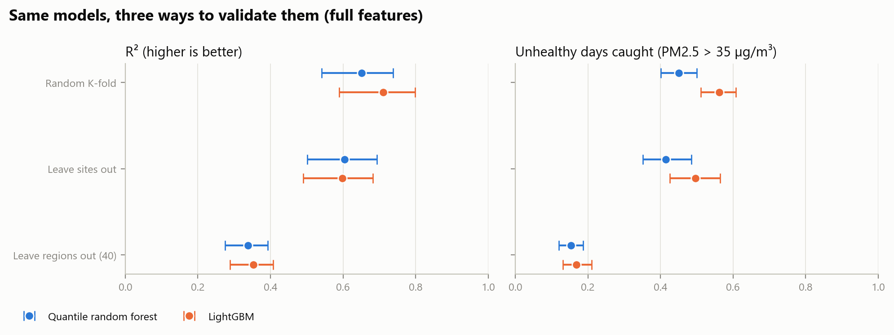
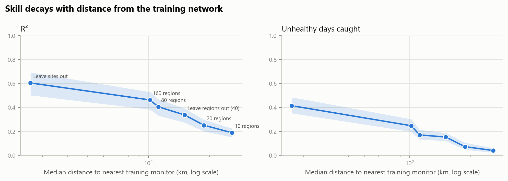
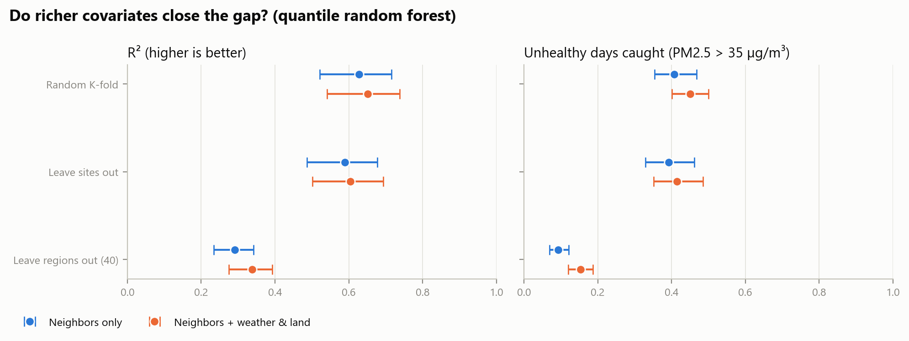
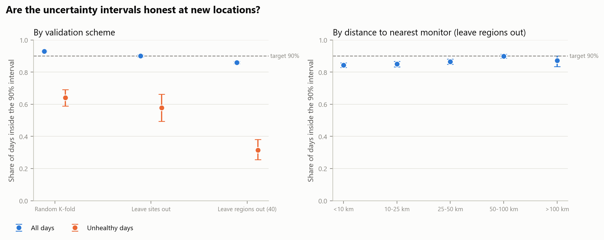
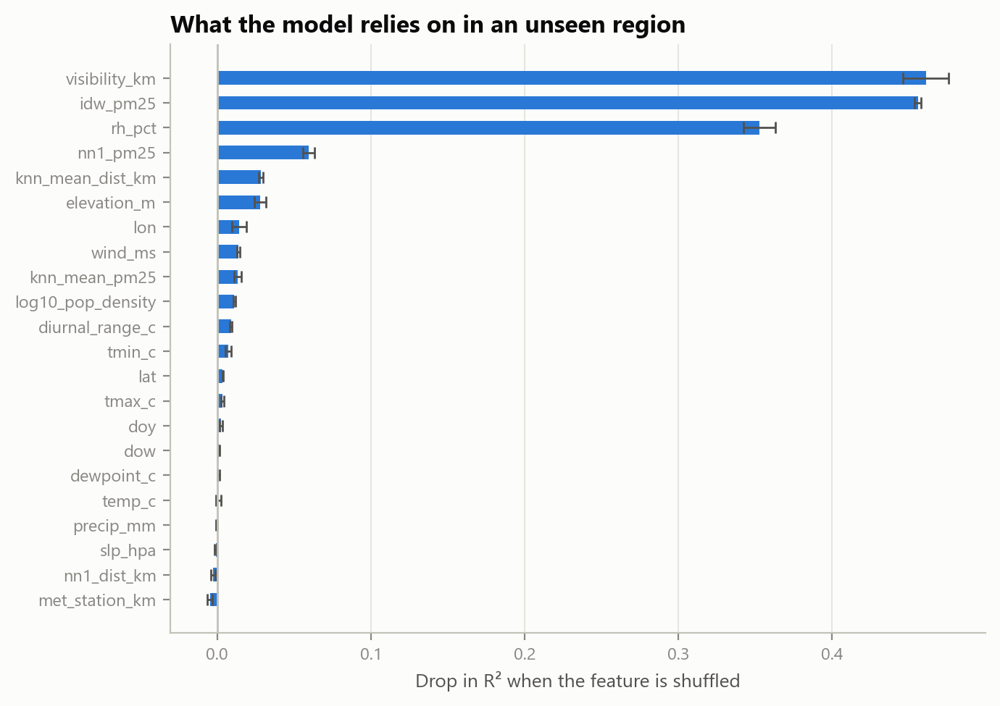
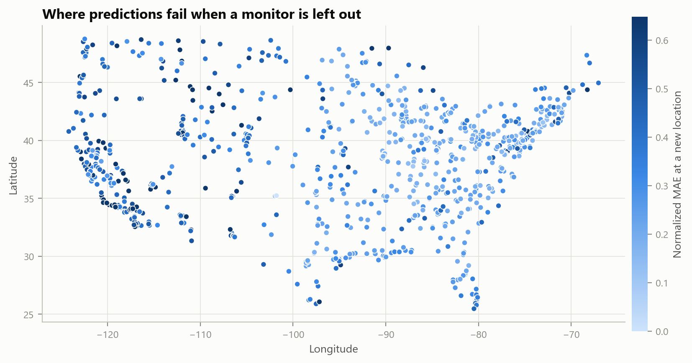

# Where do air-quality ML maps fail?
### Spatial robustness, uncertainty, and equity of PM2.5 prediction at 1,008 U.S. monitors

**Question.** Machine-learning maps of fine particulate matter (PM2.5) are usually validated with random cross-validation. How much does that overstate how well they predict at places *without* a monitor, on the *unhealthy* days that matter most, and do their uncertainty intervals stay honest there?

**Short answer (2024 data).** Random cross-validation roughly **doubles** the skill a model shows in unseen regions. The best model scores R² = 0.71 under random K-fold but 0.35 when whole regions are held out, and it catches **56% → 17%** of unhealthy-air days. Skill decays smoothly with distance to the nearest training monitor. The 90% prediction intervals look calibrated on average, but cover only **31%** of unhealthy days in unseen regions. Richer weather and land covariates help only modestly, and **which model looks best depends on how you validate it.**

---

## Data (public, no API keys)
| Source | Use |
|---|---|
| EPA AQS daily PM2.5, 2024 (parameter 88101, FRM/FEM monitors) | Target: **1,008 CONUS monitors, 324,524 site-days** |
| NOAA GSOD daily weather, 2024 | Temperature, dew point, humidity, pressure, wind, precipitation, visibility, max/min temperature. Nearest of 3 stations within 150 km (median 13 km), with gaps filled from the next-nearest station. |
| Open-Meteo elevation API (Copernicus 90 m DEM) | Monitor elevation |
| Census population estimates + Gazetteer | County population density |
| Census SAIPE 2023 | County median income and poverty rate (equity slices only, not a model input) |

`python src/download_data.py` fetches everything (~120 MB). Covariates are under 3.5% missing.

## Method
- **Features.** Lat/lon, day of year and week, plus **same-day neighbor PM2.5** from the 5 nearest *training* monitors (inverse-distance-weighted mean, nearest value, distances), rebuilt **inside every fold** so test monitors never leak into features. The full set adds weather, elevation, and density.
- **Models.** Quantile regression forest (**QRF**, point prediction plus a 90% interval from the 5th–95th quantiles) and **LightGBM**. Missing values are filled with training-fold medians.
- **Validation schemes.** *Random K-fold* over rows; *leave sites out* (whole monitors); *leave regions out* (k-means spatial blocks; 40 in the main analysis, swept over 10–160).
- **Metrics.** R², normalized MAE, **unhealthy-day recall** (observed PM2.5 > 35 µg/m³, the EPA 24-hour standard, also predicted > 35), and 90% interval coverage overall and on unhealthy days.
- **Uncertainty.** 95% CIs from a **site-level cluster bootstrap** (1,000 resamples). Repeated with 3 seeds for block and fold assignment.
- **Slices.** Distance to the nearest other monitor, county income and poverty quintiles, Utah.

## Results

**Main comparison (full features; brackets are 95% CIs):**

| Validation | QRF R² | LightGBM R² | Unhealthy days caught (LightGBM) | QRF 90% coverage: all / unhealthy days |
|---|---|---|---|---|
| Random K-fold | 0.65 [0.54, 0.74] | **0.71** [0.59, 0.80] | **56%** [51, 61] | 93% / 64% |
| Leave sites out | 0.61 [0.50, 0.69] | 0.60 [0.49, 0.68] | 50% [43, 56] | 90% / 58% |
| Leave regions out | 0.34 [0.27, 0.39] | **0.35** [0.29, 0.41] | **17%** [13, 21] | 86% / **31%** |



### Findings
1. **Random CV roughly doubles apparent skill in unseen regions.** For both models the random-K-fold and leave-regions-out CIs do not overlap. Holding out single monitors costs little (nearby monitors still inform the prediction); holding out whole regions is what exposes the gap.
2. **Skill decays smoothly with distance from the training network.** Across block sizes, R² falls from 0.61 (median 26 km to the nearest training monitor) to 0.46 (102 km), 0.34 (151 km), and 0.19 (258 km). Unhealthy-day recall falls from 42% to 4%.
   
3. **Model rankings flip with the validation scheme.** With neighbor features only, LightGBM beats the QRF under random K-fold (R² 0.68 vs 0.63) but is far worse in unseen regions (0.14 [0.10, 0.20] vs 0.29 [0.23, 0.34]). Choosing a model by random CV would pick the less robust one.
4. **Richer covariates help, modestly.** Adding weather, elevation, and density lifts leave-regions-out R² from 0.29 to 0.34 (QRF; CIs overlap) and unhealthy-day recall from 9% to 15%. The gap to random CV remains.
   
5. **Intervals look honest on average but fail when it matters.** QRF 90% intervals cover 86–93% of all days, but on unhealthy days coverage falls to 64% (random K-fold), 58% (new sites), and **31% (unseen regions)**.
   
6. **Utah.** At held-out Utah monitors (23 sites), R² is 0.72 when only the site is removed but **0.03 [−0.07, 0.13]** when its region is removed. Of Utah's 26 unhealthy site-days, the model caught at most 1.
7. **Equity: no consistent income gradient at county scale.** In unseen regions, normalized error is *highest* in the richest county quintile (0.39 vs 0.29–0.33). For new sites, the lowest-income quintile has the lowest unhealthy-day recall (28% vs 32–52%). County income is too coarse to support an equity claim either way; tract-level analysis is the next step.
8. **Robustness checks.** Leave-regions-out R² is 0.34, 0.32, and 0.33 across three block and fold seeds.
9. **What the model relies on in an unseen region** (permutation importance, LightGBM): weather-station **visibility**, **same-day neighbor PM2.5**, and **relative humidity**.
   



## Limitations (read before citing any number)
- **One year (2024), regulatory monitors only.** Low-cost and mobile sensors (PurpleAir; Utah TRAX/bus monitors) are not included.
- **Visibility partly measures the same particles.** Reduced visibility is caused partly by the aerosol that PM2.5 measures, so its high importance is expected. A model without it is a planned ablation.
- **No satellite aerosol optical depth, reanalysis boundary-layer height, or land-use rasters.** These are known strong predictors, especially for winter inversions in the Salt Lake Valley.
- **County-level income and poverty are coarse.** Do not read finding 7 as evidence of no disparity.
- **Small Utah sample** (23 monitors, 26 unhealthy site-days).
- **R² CIs are wide** because a few wildfire-smoke sites dominate the variance.

## Next steps
1. A Salt Lake Valley case study: add PurpleAir (EPA-corrected) and Utah mobile monitors, ERA5 boundary-layer height, and NLCD land use. Use winter inversions as the stress test.
2. Census-tract equity analysis of errors and interval coverage.
3. Spatially aware uncertainty (conformal prediction calibrated by distance to the training network) and Bayesian Neural Fields.
4. Use distance to the training network as a reliability flag on published maps.

## Companion study
[aq-forecast-reliability](https://github.com/razon1494/aq-forecast-reliability) asks the same question in time instead of space: hourly next-hour PM2.5 forecasts at 18 Utah sites, tested on 2025 and at 4 held-out sites. There too, a model that wins on average is worse than simple persistence on high-pollution hours, and its intervals miss most of them.

## Reproduce
```
pip install -r requirements.txt
python src/download_data.py      # ~120 MB of public data into data/raw/
python src/run_study.py          # ~40 min on a laptop CPU; writes results/study and figures/study
python src/replot_study.py       # regenerate figures from saved results (seconds)
python -m pytest -q              # 13 unit tests (leakage, folds, metrics, parsing)
```

| File | Role |
|---|---|
| `src/data.py` | EPA AQS and SAIPE loading |
| `src/covariates.py` | GSOD weather, elevation, population density |
| `src/features.py` | Leak-free neighbor features and fold schemes |
| `src/models.py` | QRF and LightGBM wrappers |
| `src/evaluate.py` | Metrics, interval coverage, cluster bootstrap, slices |
| `src/run_study.py` | Full study (E1 main, E2 block sweep, E4 importance, E5 seeds) |
| `src/run_pilot.py` | Original pilot (neighbors-only RF); outputs in `results/pilot`, `figures/pilot` |

*Author: Mohammad Arifur Rahman. Code under MIT License; data from U.S. EPA, NOAA, the U.S. Census Bureau, and Open-Meteo.*
